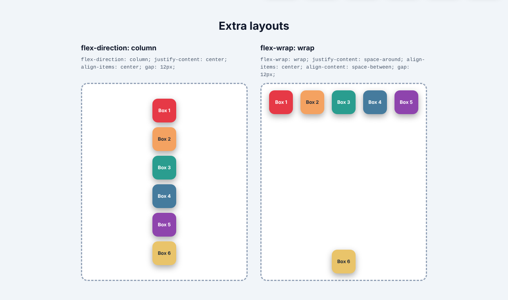
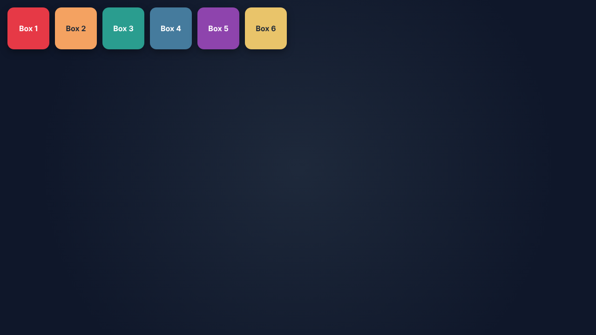
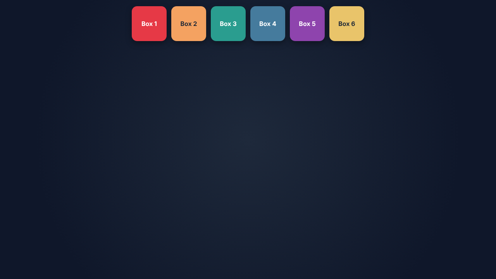
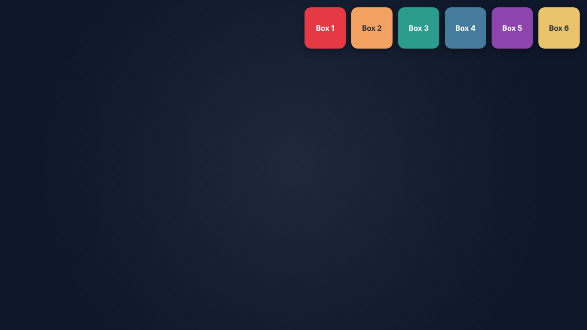
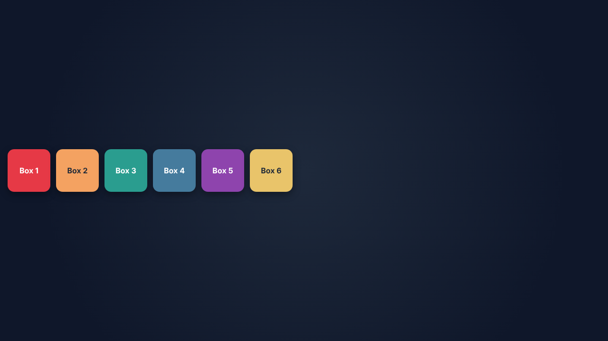
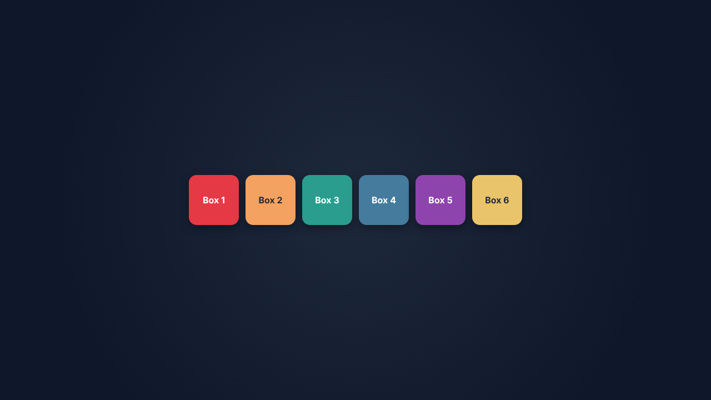
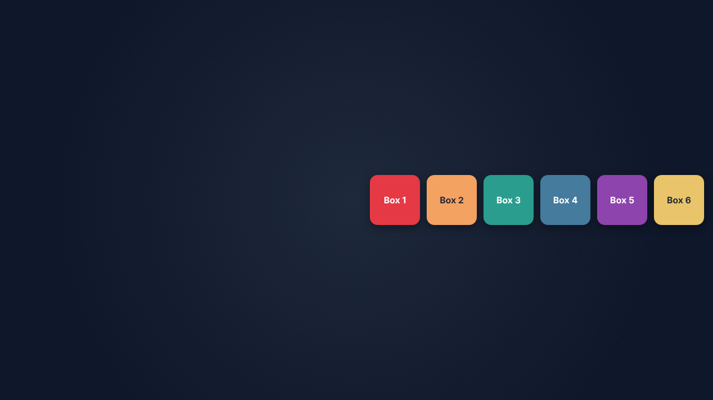
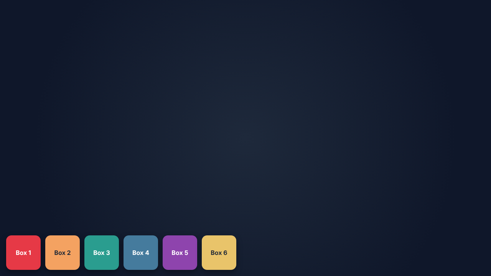
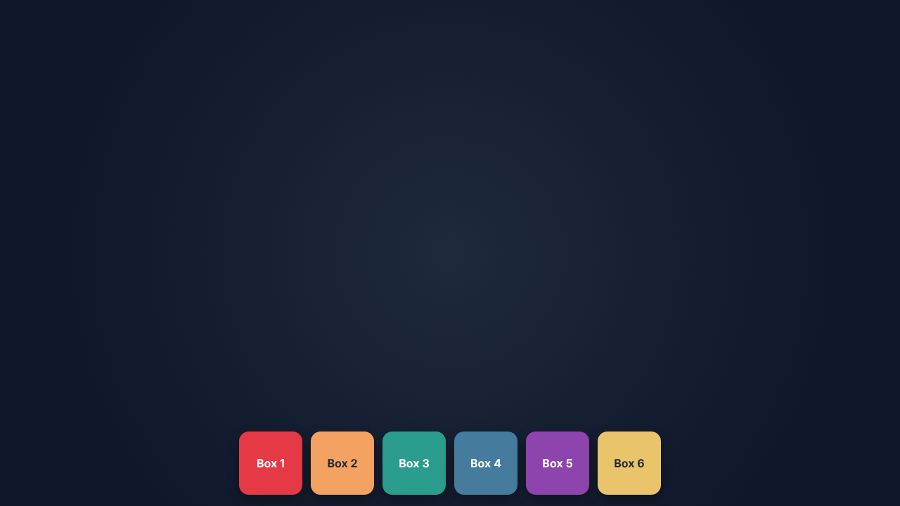
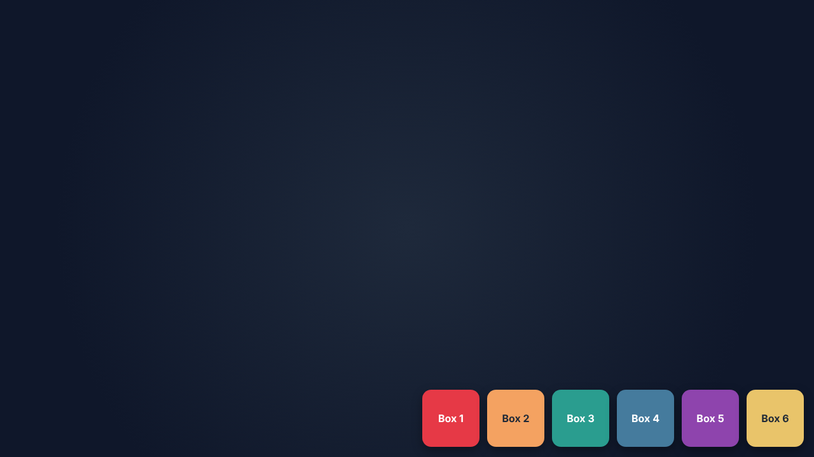

# Week 2 – Flexbox Practice

**Name:** SEBERA Isimbi Ange Thressy

A full-screen Flexbox playground built with **HTML and CSS only** (no JavaScript). Six coloured boxes travel through all 9 positions of a `100vh` flex container, driven by a CSS `@keyframes` animation that changes `justify-content`, `align-items` and `align-content`.

| | Link |
|---|---|
| 🎥 **Video walkthrough** | https://youtu.be/yrIpIy9id-0
| 🌐 **Live demo** |

---

## Files

```
week2-flexbox-practice/
├── index.html     # the container, 6 boxes, and 2 extra layouts
├── style.css      # all Flexbox + the @keyframes animation
├── README.md      # this file
└── screenshots/   # images used below
```

## How it works

1. `.container` is a flex container that fills the screen (`width: 100%; height: 100vh;`).
2. It holds 6 boxes (`.box-1` … `.box-6`), each with its own colour and number.
3. The animation `moveBoxes` lasts **18 s** and loops forever. 18 s ÷ 9 positions = **2 seconds per position**.
4. Inside `@keyframes`, each position changes the alignment properties, so the whole group of boxes jumps from Top Left → Top Center → … → Bottom Right and then starts again.

Hover over the page to pause the animation.

## Flexbox properties used

| Property | Where | What it does |
|---|---|---|
| `display: flex` | `.container`, `.box`, `.demo` | Turns an element into a flex container, so its children become flex items laid out in a row by default. |
| `flex-direction` | `.container` (`row`), `.demo-column` (`column`) | Sets the **main axis**. `row` = horizontal (left → right). `column` = vertical (top → bottom). |
| `justify-content` | animated in `@keyframes` | Aligns items along the **main axis** (horizontal in a row): `flex-start` = left, `center` = middle, `flex-end` = right. Also `space-around` in the wrap demo. |
| `align-items` | animated in `@keyframes` | Aligns items along the **cross axis** (vertical in a row) within each line: `flex-start` = top, `center` = middle, `flex-end` = bottom. |
| `align-content` | animated in `@keyframes`, `.demo-wrap` | Aligns the **lines** of a wrapping container along the cross axis. It only has an effect when `flex-wrap: wrap` is set, which is why it is animated together with `align-items`. `space-between` pushes the lines to opposite edges in the wrap demo. |
| `flex-wrap: wrap` | `.container`, `.demo-wrap` | Lets items drop onto a new line instead of overflowing. |
| `gap` | `.container`, `.demo` | Adds even space between boxes without using margins. |
| `flex: 0 0 auto` | `.box` | Boxes never grow or shrink; they keep their 90 × 90 px size. |

## The 9 positions

Each position is a combination of `justify-content` (horizontal) and `align-items` / `align-content` (vertical) with `flex-direction: row`.

| # | Position | CSS |
|---|---|---|
| 1 | **Top Left** | `justify-content: flex-start; align-items: flex-start; align-content: flex-start;` |
| 2 | **Top Center** | `justify-content: center; align-items: flex-start; align-content: flex-start;` |
| 3 | **Top Right** | `justify-content: flex-end; align-items: flex-start; align-content: flex-start;` |
| 4 | **Middle Left** | `justify-content: flex-start; align-items: center; align-content: center;` |
| 5 | **Center** | `justify-content: center; align-items: center; align-content: center;` |
| 6 | **Middle Right** | `justify-content: flex-end; align-items: center; align-content: center;` |
| 7 | **Bottom Left** | `justify-content: flex-start; align-items: flex-end; align-content: flex-end;` |
| 8 | **Bottom Center** | `justify-content: center; align-items: flex-end; align-content: flex-end;` |
| 9 | **Bottom Right** | `justify-content: flex-end; align-items: flex-end; align-content: flex-end;` |

### Animation timeline

| Time | Keyframe | Position |
|---|---|---|
| 0 – 2 s | `0%, 10%` | Top Left |
| 2 – 4 s | `11.1%, 21%` | Top Center |
| 4 – 6 s | `22.2%, 32%` | Top Right |
| 6 – 8 s | `33.3%, 43%` | Middle Left |
| 8 – 10 s | `44.4%, 54%` | Center |
| 10 – 12 s | `55.5%, 65%` | Middle Right |
| 12 – 14 s | `66.6%, 76%` | Bottom Left |
| 14 – 16 s | `77.7%, 87%` | Bottom Center |
| 16 – 18 s | `88.8%, 100%` | Bottom Right |

Alignment keywords can't be smoothly blended, so the browser switches between them at the midpoint between two keyframes. Holding each value for most of its slot (for example `0%, 10%`) makes every position stay put for about two seconds before the boxes jump to the next one.

```css
.container {
  display: flex;
  flex-wrap: wrap;
  gap: 12px;
  width: 100%;
  height: 100vh;
  animation-name: moveBoxes;
  animation-duration: 18s;
  animation-timing-function: linear;
  animation-iteration-count: infinite;
}

@keyframes moveBoxes {
  0%, 10%     { justify-content: flex-start; align-items: flex-start; align-content: flex-start; } /* Top Left */
  11.1%, 21%  { justify-content: center;     align-items: flex-start; align-content: flex-start; } /* Top Center */
  /* ...and so on for all 9 positions... */
}
```

## Extra layouts

Scroll below the animated container to see two more layouts:

- **`flex-direction: column`** – the boxes stack vertically and are centred with `justify-content: center` and `align-items: center`.
- **`flex-wrap: wrap`** – the boxes wrap onto two lines; `justify-content: space-around` spreads each line horizontally and `align-content: space-between` pushes the two lines to the top and bottom edges.



## Screenshots

| Top Left | Top Center | Top Right |
|---|---|---|
|  |  |  |
| **Middle Left** | **Center** | **Middle Right** |
|  |  |  |
| **Bottom Left** | **Bottom Center** | **Bottom Right** |
|  |  |  |

## Rules followed

- HTML and CSS only – no JavaScript files.
- Boxes are positioned with Flexbox only: no Grid, no `position: absolute`, no margins for positioning.
- `animation-iteration-count: infinite` on the container.


